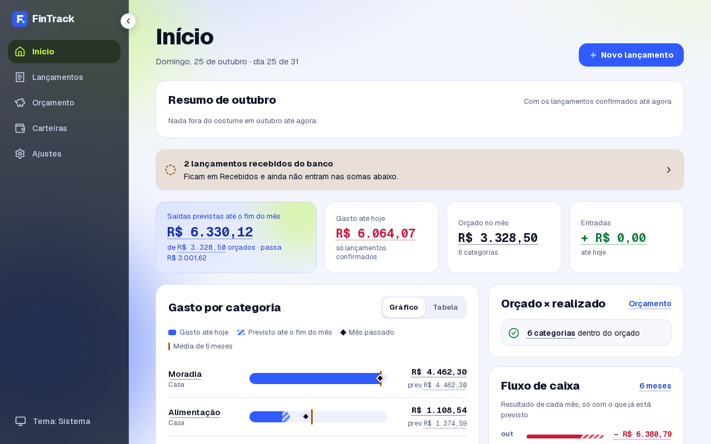
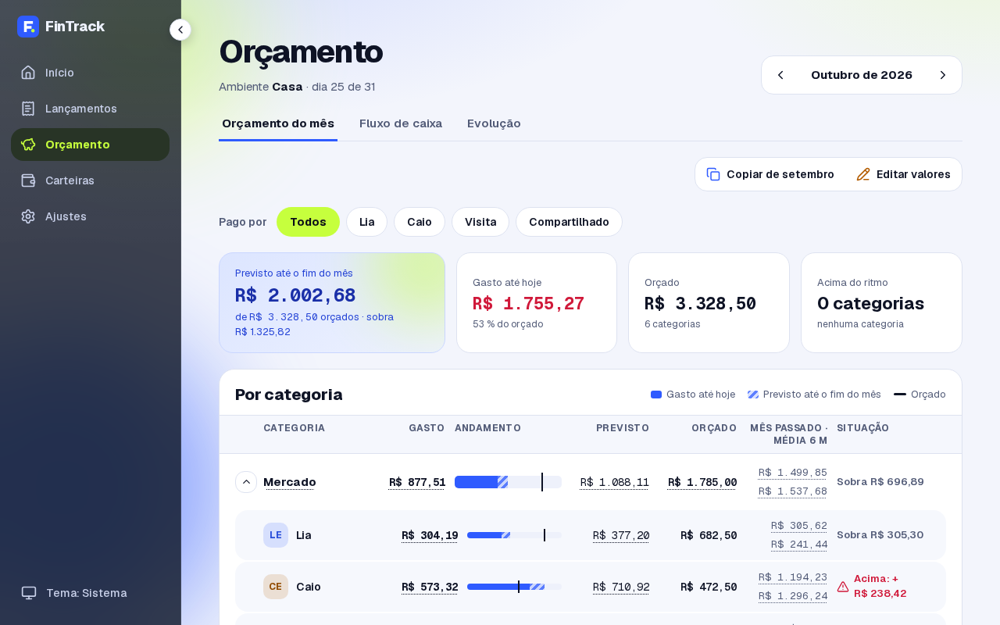
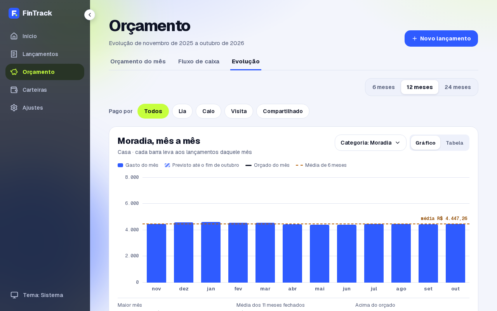
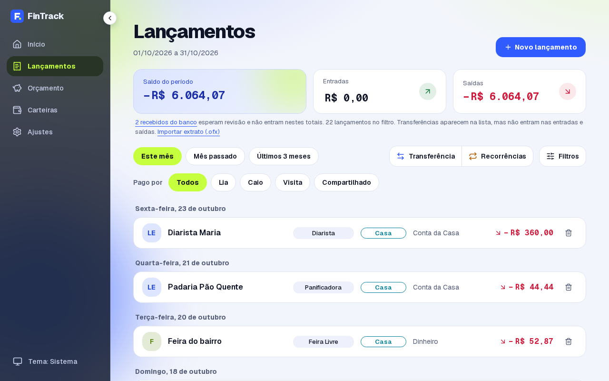
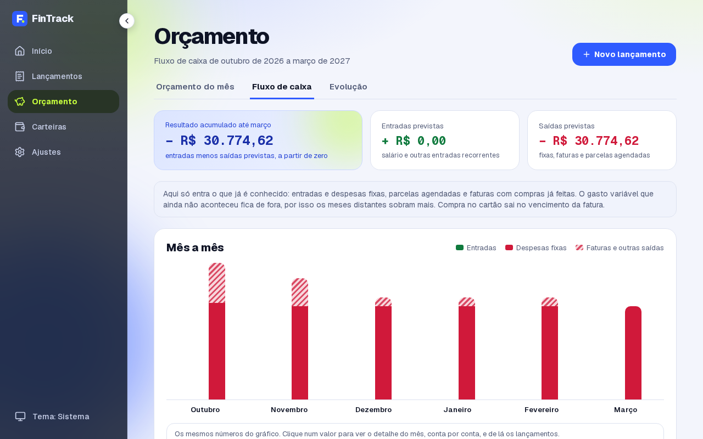
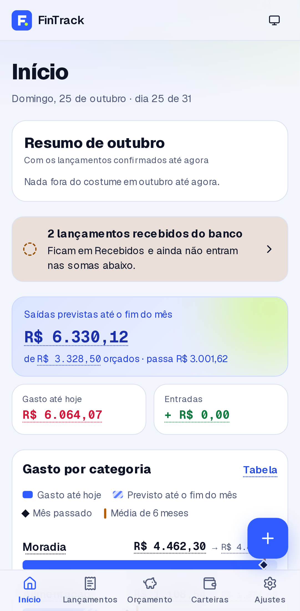
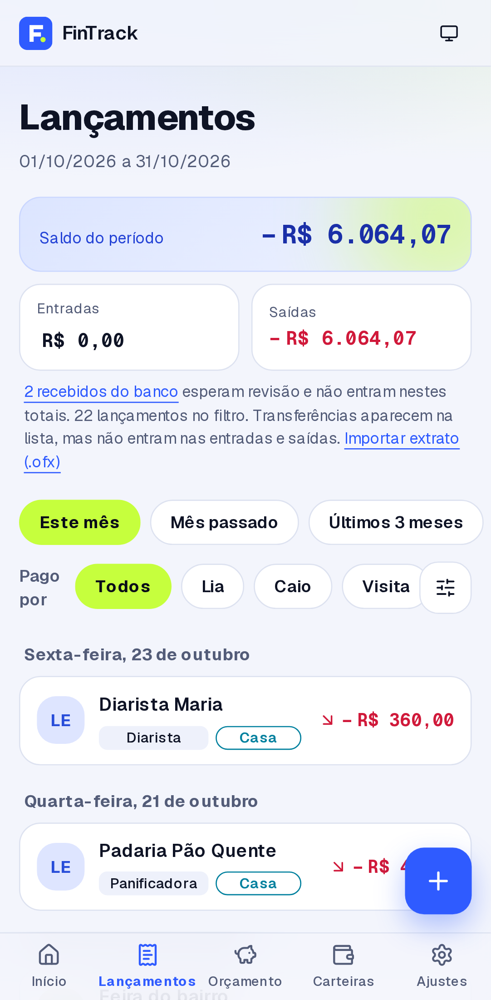

# FinTrack

[](https://github.com/danillo-valle/fintrack/actions/workflows/ci.yml)

Controle financeiro pessoal e da casa: ambientes pessoais e compartilhados, cartões com
adicionais, orçamento e importação de extratos e faturas. Construído em 12 módulos, cada um
acompanhado por uma [milestone](https://github.com/danillo-valle/fintrack/milestones).

**[FinTrack por dentro](https://danillo-valle.github.io/fintrack/)**: a arquitetura em C4 e o mapa
do fluxo de cada tela (o que roda no navegador, o que chama no servidor, o que toca no banco e o
que sai para fora), gerados do código a cada versão. Também: as
[decisões de arquitetura](docs/adr/README.md), o [relatório com nota](docs/arquitetura/relatorio.md)
e o [runbook de incidente](docs/operacao/incidente.md).

## Telas

Capturas com a casa fictícia do seed (24 meses de dados sintéticos), no tema do seu GitHub (claro
ou escuro). Gravadas por `pnpm capturas`; não há demonstração no ar.

<picture>
  <source media="(prefers-color-scheme: dark)" srcset="docs/capturas/inicio-escuro-computador.png">
  
</picture>

| Orçamento do mês                                                                                                                                                                                                                                  | Evolução mês a mês                                                                                                                                                                                                                   |
| ------------------------------------------------------------------------------------------------------------------------------------------------------------------------------------------------------------------------------------------------- | ------------------------------------------------------------------------------------------------------------------------------------------------------------------------------------------------------------------------------------ |
| <picture> <source media="(prefers-color-scheme: dark)" srcset="docs/capturas/orcamento-escuro-computador.png">  </picture> | <picture> <source media="(prefers-color-scheme: dark)" srcset="docs/capturas/evolucao-escuro-computador.png">  </picture>     |
| **Lançamentos**                                                                                                                                                                                                                                   | **Fluxo de caixa**                                                                                                                                                                                                                   |
| <picture> <source media="(prefers-color-scheme: dark)" srcset="docs/capturas/lancamentos-escuro-computador.png">  </picture>                 | <picture> <source media="(prefers-color-scheme: dark)" srcset="docs/capturas/fluxo-de-caixa-escuro-computador.png">  </picture> |

No celular:

<p>
<picture>
  <source media="(prefers-color-scheme: dark)" srcset="docs/capturas/inicio-escuro-celular.png">
  
</picture>
<picture>
  <source media="(prefers-color-scheme: dark)" srcset="docs/capturas/lancamentos-escuro-celular.png">
  
</picture>
</p>

## Stack

Next.js 16 · React 19 · TypeScript · Tailwind CSS v4 · shadcn/ui · pnpm + Turborepo ·
PostgreSQL 17 + Prisma 7 · Better Auth (2FA, passkeys) · Vitest · Playwright + axe · Python: FastAPI, pdfplumber e scikit-learn (M09, M10)

## Rodando localmente

Pré-requisitos: Node 24 (veja `.node-version`), pnpm (versão em `package.json`) e Docker.

```bash
cp .env.example .env   # e preencha o que está marcado com TROQUE
pnpm install           # instala dependências e os hooks de Git
pnpm db:up             # Postgres e Mailpit (e-mails de teste em http://localhost:8025)
pnpm db:deploy         # cria as tabelas
pnpm db:seed           # casa fictícia com 24 meses de dados sintéticos
pnpm dev               # http://localhost:3000
pnpm check             # lint, tipos, testes e build, igual ao CI
pnpm e2e               # testes de ponta a ponta
pnpm e2e:producao      # os mesmos, contra o build de produção (como o CI)
pnpm capturas          # refaz as capturas desta página (roda o seed de novo)
pnpm test:integration  # regras do banco contra o Postgres
pnpm --filter @fintrack/flow-map generate   # refaz o mapa do fluxo (docs/arquitetura/fluxo.json)
pnpm --filter @fintrack/flow-map site       # monta o site "FinTrack por dentro" em dist/site
```

## Estrutura

```
apps/web/          app Next.js
packages/core/     regras puras: dinheiro em centavos, datas, fatura do cartão
packages/db/       schema, migrações, seed e cliente do Prisma
packages/config/   configuração compartilhada de TypeScript
packages/importers/  dados do banco: Meu Pluggy, OFX e o cliente do PDF
packages/flow-map/ o mapa do fluxo tirado do código e o site do GitHub Pages
services/ml/       o serviço Python: fatura em PDF, classificador e IA local
docs/adr/          decisões de arquitetura
docs/arquitetura/  o C4, o mapa do fluxo (fluxo.json) e o relatório com nota
docs/operacao/     runbook de operação e de incidente
docs/modelo-de-dados.md  diagrama das tabelas
samples/           dados sintéticos para testes (nunca dados reais)
```

## Categorização

Cada lançamento passa por uma cascata, na ordem: as **regras** do lar, o **histórico** das
carteiras que a pessoa vê, a **categoria do banco** (Meu Pluggy) e um **classificador**
(scikit-learn, um modelo por carteira, treinado toda madrugada no próprio servidor). A tela
mostra quem sugeriu e com que confiança; abaixo de 80 % o classificador não sugere
([ADR-015](docs/adr/0015-categorizacao-inteligente.md)). Nenhuma descrição sai do servidor.

Avaliação no conjunto rotulado sintético (`samples/categorizacao/rotulado.csv`), refeita pelo CI
em todo pull request (falha abaixo do mínimo):

<!-- avaliacao-classificador: início -->

| Medida (conjunto sintético, 90 descrições de teste) | Resultado |
| --------------------------------------------------- | --------- |
| Acerto do classificador (mínimo 85,0 %)             | 94,4 %    |
| Resolvido sem LLM (confiança ≥ 80 %)                | 87,8 %    |
| Acerto no que foi resolvido sem LLM                 | 100,0 %   |

<!-- avaliacao-classificador: fim -->

O percentual real de cada casa (categorizado sem IA, por camada) fica em **Ajustes ›
Categorização**.

## Proteções

- Hooks locais bloqueiam segredos, arquivos de extrato ou fatura e mensagens de commit fora do padrão.
- O CI repete as verificações e procura segredos em todo o histórico.
- A branch `main` só aceita pull request com CI verde.
- Cadastro fechado, 2FA obrigatório, passkeys, limite de tentativas e reautenticação antes de
  ações sensíveis ([ADR-003](docs/adr/0003-autenticacao.md)).
- Dinheiro exato (`NUMERIC(14,2)` e centavos em `bigint`), importação idempotente e auditoria que
  só acrescenta, garantidos no próprio banco ([ADR-004](docs/adr/0004-modelo-de-dados.md)).

## Licença

MIT
