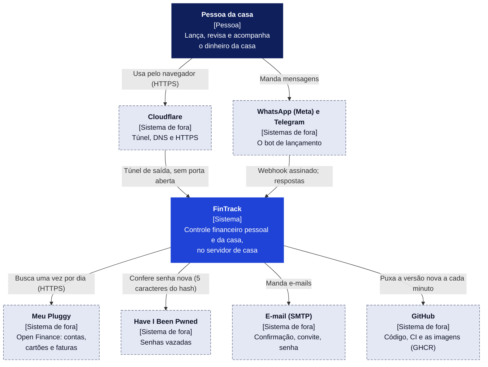
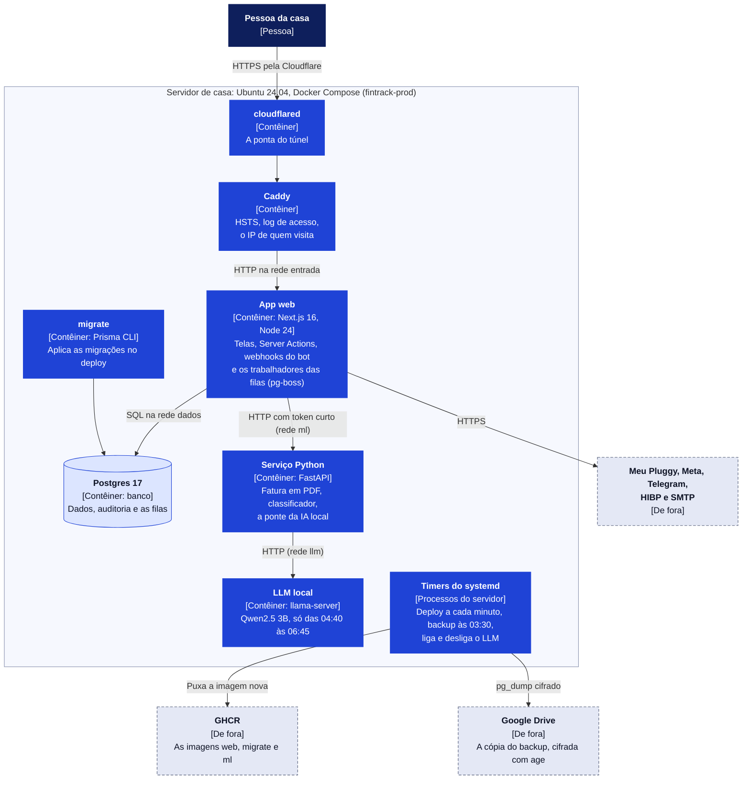
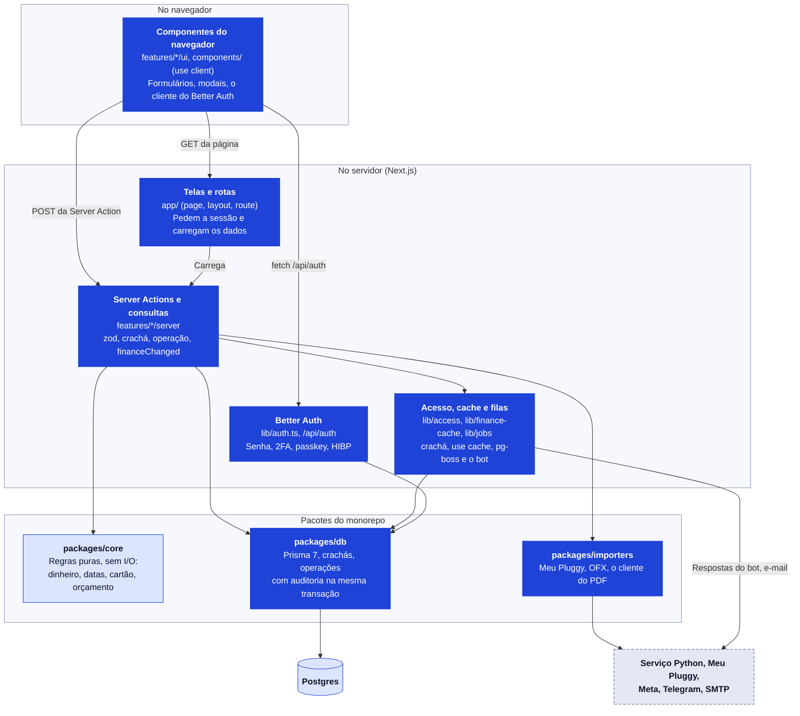

# Arquitetura do FinTrack em C4

Três níveis do modelo [C4](https://c4model.com): o **contexto** (quem usa e com quem o sistema
fala), os **contêineres** (o que roda no servidor de casa) e os **componentes** do app web (como o
código se divide). O caminho de cada tela até o banco, tirado do código, está no mapa do fluxo
(`docs/arquitetura/fluxo.json`, gerado pelo `packages/flow-map`) e no site
[FinTrack por dentro](https://danillo-valle.github.io/fintrack/).

Os diagramas são texto (Mermaid): o GitHub os desenha aqui mesmo, e o site os transforma em
imagem a cada versão. Um diagrama que não desenha quebra o build do site (ADR-023).

Legenda: azul-escuro é pessoa; azul é o FinTrack (sistema, contêiner ou componente); cinza com
borda tracejada é de fora; o cilindro é onde os dados ficam.

## Nível 1 · Contexto

- **Uma pessoa, muitas casas**: cada pessoa tem o seu ambiente e participa de um lar; ambientes
  compartilhados juntam os gastos de várias pessoas (ADR-004, ADR-006).
- **Nada entra na rede de casa**: o túnel da Cloudflare é uma conexão de saída, e o deploy é
  puxado pelo servidor (ADR-005).
- **Só o necessário sai**: do HIBP vão 5 caracteres do hash; do bot, só a resposta; o número de
  quem escreve fica como HMAC (ADR-018, ADR-022).

## Nível 2 · Contêineres

- **Redes separadas**: o Caddy só alcança o app (`entrada`); o banco só o app e o `migrate`
  (`dados`); o serviço Python só o app (`ml`); o LLM só o serviço Python (`llm`). Nenhum
  contêiner publica porta (ADR-005, ADR-014, ADR-016).
- **Deploy com volta automática**: o timer baixa a imagem, faz o backup, migra, troca o app e
  confere o `/api/health` com o commit novo; se não responder, volta (ADR-005).
- **As filas moram no Postgres** (pg-boss): seis filas, com quem põe trabalho em cada uma no
  mapa do fluxo (ADR-011).

## Nível 3 · Componentes do app web

- **A fronteira do navegador é o `"use client"`**: o que roda no aparelho só chama o servidor por
  Server Action (POST da própria página) ou pelo Better Auth (`/api/auth`). O mapa do fluxo lista,
  por tela, os componentes do navegador, o que ela carrega e as actions dos formulários.
- **Banco só em `features/*/server` e `lib`** (regra do ESLint); **tudo que toca uma carteira
  passa pelo crachá** tipado (ADR-006), e o mapa confere que toda tela e toda action pedem a
  sessão.
- **Regra de negócio em `packages/core`**, pura e testada (inclusive por propriedade); o banco
  repete as regras críticas em CHECK e gatilho (ADR-004).
