# Modelo de dados do FinTrack

Mapa das tabelas do domínio (M04). O schema completo, comentado campo a campo, está em
`packages/db/prisma/schema/`, um arquivo por assunto. As decisões estão no
[ADR-004](adr/0004-modelo-de-dados.md).

> Este diagrama é conferido por teste: `packages/db/src/docs-sync.test.ts` falha se um modelo
> do schema não aparecer aqui. Mudou o schema? Atualize o diagrama no mesmo PR.

## A ideia central: quem paga × de quem é

Todo lançamento responde três perguntas, cada uma numa coluna diferente:

| Pergunta   | Coluna                           | Exemplo                                      |
| ---------- | -------------------------------- | -------------------------------------------- |
| Quem paga? | `accountId`, `cardId` e `method` | fatura do Cartão Master, final 1003, crédito |
| De quem é? | `walletId` (o **ambiente**)      | "Casa"                                       |
| O que é?   | `categoryId`                     | Alimentação › Mercado                        |

Por isso a compra do mercado no cartão **adicional** de uma pessoa, que cai na fatura da
**titular**, pode ser um gasto do ambiente **Casa**. A fatura soma por conta; o ambiente
soma por `walletId`. As duas somas estão certas, porque respondem perguntas diferentes.

## Diagrama

O GitHub desenha o bloco abaixo como diagrama. Leia as linhas assim: `||--o{` é "um para
muitos" (um ambiente tem zero ou mais lançamentos); `|o--o{` é "zero ou um para muitos".

```mermaid
erDiagram
    User ||--o{ HouseholdMember : "faz parte de"
    User ||--o{ WalletMember : "participa de"
    User |o--o{ FinancialAccount : "é titular de"
    User |o--o{ PaymentCard : "porta"
    User |o--o{ Transaction : "lançou"
    User ||--o{ ProviderConnection : "conectou"

    Household ||--o{ HouseholdMember : tem
    Household ||--o{ Wallet : "tem (ambientes)"
    Household ||--o{ FinancialAccount : tem
    Household ||--o{ Category : tem
    Household ||--o{ CategoryRule : tem
    HouseholdMember ||--o{ WalletMember : "só membro do grupo"
    Household ||--o{ HouseholdInvite : "convites (M06)"
    User |o--o{ HouseholdInvite : "criou / aceitou"

    Wallet ||--o{ WalletMember : "com papel"
    Wallet ||--o{ FinancialAccount : "gere"
    Wallet ||--o{ Transaction : "de quem é"
    Wallet ||--o{ Budget : planeja
    Wallet ||--o{ Recurrence : "de quem é"
    Wallet ||--o{ InstallmentGroup : "de quem é"
    Wallet ||--o{ ProviderConnection : recebe

    FinancialAccount ||--o{ PaymentCard : "tem cartões"
    FinancialAccount ||--o{ Transaction : "quem paga"
    FinancialAccount ||--o{ CardStatement : "fatura (cartão)"
    FinancialAccount ||--o{ InstallmentGroup : parcela
    FinancialAccount ||--o{ Recurrence : "debita"
    PaymentCard |o--o{ Transaction : "passado em"
    PaymentCard |o--o{ Recurrence : "assinatura em"
    ProviderConnection |o--o{ FinancialAccount : sincroniza
    ProviderConnection ||--o{ SyncRun : executa
    ProviderConnection ||--o{ ProviderItem : "bancos (M09.1)"
    FinancialAccount ||--o| AccountBalance : "saldo do banco (M09.1)"
    CardStatement ||--o{ StatementCharge : "IOF, juros (M09.1)"
    CardStatement ||--o{ StatementPayment : "pago em (M09.1)"
    Wallet |o--o{ PaymentCard : "compras importadas entram em (M09.1)"
    Transaction ||--o{ TransactionMatch : "recebido do par (M09.2)"
    Transaction ||--o{ TransactionMatch : "seu lançamento (M09.2)"
    FinancialAccount |o--o{ FileImport : "extrato importado (M09.3)"
    FileImport |o--o{ Transaction : "linhas do arquivo (M09.3)"
    CardStatement |o--o{ FileImport : "fatura em PDF (M09.4)"

    Category |o--o{ Category : "subcategoria de"
    Category |o--o{ Transaction : classifica
    Category ||--o{ CategoryRule : "alvo de"
    Category ||--o{ Budget : "limite de"
    Budget ||--o{ BudgetShare : "dividido em (M08)"
    HouseholdMember |o--o{ BudgetShare : "parte de"
    Category |o--o{ Recurrence : classifica

    CardStatement |o--o{ Transaction : "inclui (competência)"
    InstallmentGroup ||--|{ Transaction : "parcelas 1..N"
    Recurrence |o--o{ Transaction : "gera (todo mês)"
    Transaction |o--o{ Transaction : "estorno de"

    Household ||--o{ CategorizationExample : "exemplos de treino (M07)"
    Category ||--o{ CategorizationExample : "corrigido para"
    Transaction |o--o{ CategorizationExample : "corrigido em"
    Wallet ||--o| ClassifierModel : "modelo do classificador (M10.1)"
    Transaction ||--o| LocalAiAttempt : "o que a IA local respondeu (M10.2b)"
    Category |o--o{ LocalAiAttempt : "mãe da categoria nova proposta"
    HouseholdMember ||--o| BotLink : "número do WhatsApp (M11)"
    HouseholdMember ||--o{ BotLinkCode : "código de vínculo"
    HouseholdMember ||--o| BotPreference : "padrões do bot"
    HouseholdMember ||--o{ BotDraft : "propostas do bot"
    BotDraft |o--o| Transaction : "virou (Confirmar)"
    BotDraft |o--o| InstallmentGroup : "virou a compra parcelada"
    BotMessage |o--o| BotDraft : "criou ou decidiu"
    BotReplyCount {
        string phoneNumberId PK "o número do bot na Meta"
        char month PK "AAAA-MM, São Paulo"
        int used "0 a 1000 (para em 900)"
        timestamp warnedAt "aviso dos 850"
    }

    Household {
        uuid id PK
        string name
    }
    HouseholdMember {
        uuid householdId PK, FK
        string userId PK, FK
        enum role "OWNER | MEMBER"
    }
    HouseholdInvite {
        uuid id PK
        uuid householdId FK
        char64 tokenHash UK "SHA-256 do segredo do link"
        string email "minúsculas"
        enum role "OWNER | MEMBER"
        datetime expiresAt "72 h"
        datetime acceptedAt "uso único"
        datetime revokedAt
    }
    Wallet {
        uuid id PK
        uuid householdId FK
        enum kind "PERSONAL | SHARED"
        string name "ambiente: Casa, Viagem..."
    }
    WalletMember {
        uuid walletId PK, FK
        string userId PK, FK
        uuid householdId FK "membro do grupo"
        enum role "OWNER | EDITOR | VIEWER"
    }
    FinancialAccount {
        uuid id PK
        uuid householdId FK
        uuid walletId FK "ambiente onde é gerida"
        string holderId FK "titular"
        enum kind "CHECKING | SAVINGS | CREDIT_CARD | MEAL_VOUCHER | CASH"
        smallint closingDay "só cartão"
        smallint dueDay "só cartão"
    }
    PaymentCard {
        uuid id PK
        uuid accountId FK
        string holderId FK "portador"
        string brand "bandeira"
        char4 lastFour "só 4 dígitos"
        enum form "PHYSICAL | VIRTUAL | VIRTUAL_TEMPORARY"
        bool isAdditional
        bool sharedPurchases "compras conjuntas (M07.4)"
    }
    Category {
        uuid id PK
        uuid householdId FK
        uuid parentId FK
        enum kind "EXPENSE | INCOME"
    }
    CategoryRule {
        uuid id PK
        uuid categoryId FK
        string pattern "minúsculas"
        enum match "CONTAINS | STARTS_WITH | EQUALS"
    }
    Budget {
        uuid id PK
        uuid walletId FK
        uuid categoryId FK
        date month "sempre dia 1"
        decimal amount "14,2"
    }
    BudgetShare {
        uuid id PK
        uuid budgetId FK
        string userId FK "nulo = Compartilhado"
        decimal amount "14,2, soma = Budget.amount"
    }
    Recurrence {
        uuid id PK
        uuid walletId FK
        uuid accountId FK
        uuid cardId FK
        enum kind "FIXED_BILL | SUBSCRIPTION | INCOME"
        enum method
        decimal amount "14,2 com sinal"
        smallint dayOfMonth
    }
    Transaction {
        uuid id PK
        uuid householdId FK
        uuid walletId FK "de quem é"
        uuid accountId FK "quem paga"
        uuid cardId FK "com qual cartão"
        enum method "CREDIT | DEBIT | PIX | BOLETO | ..."
        decimal amount "14,2 com sinal"
        date occurredOn
        enum status "PENDING | SCHEDULED | CONFIRMED"
        enum source "MANUAL | OFX | PDF | OPEN_FINANCE | BOT | RECURRENCE"
        string externalId "único por conta e origem"
        uuid transferId "dois lados"
        enum categorizedBy "MANUAL | RULE | HISTORY (M07) | PROVIDER | CLASSIFIER (M10.1) | LLM (M10.2b)"
        smallint categorizationConfidence "0 a 100, da camada (M10.1)"
        timestamp deletedAt "exclusão lógica"
        char providerCardLastFour "final que o banco mandou (M09.2)"
        timestamp reviewedAt "conferido (M09.2)"
        uuid mergedIntoId "juntado ao recebido (M09.2)"
        uuid fileImportId FK "arquivo de origem: OFX (M09.3) ou PDF (M09.4)"
    }
    TransactionMatch {
        uuid id PK
        uuid receivedId FK "o que veio do banco"
        uuid ownId FK "o seu lançamento"
        enum kind "SAME | INSTALLMENT | REFUND"
        enum status "CONFIRMED | REJECTED | UNDONE"
        json receivedBefore "para o Desfazer"
    }
    CategorizationExample {
        uuid id PK
        uuid householdId FK
        uuid transactionId FK
        string description
        uuid fromCategoryId FK "o que estava"
        enum fromSource "quem tinha decidido"
        uuid toCategoryId FK "o que a pessoa escolheu"
    }
    ClassifierModel {
        uuid id PK
        uuid householdId FK
        uuid walletId FK "um por carteira"
        timestamp trainedAt
        int exampleCount "20 ou mais"
        char trainingHash "SHA-256 dos exemplos"
    }
    LocalAiAttempt {
        uuid transactionId PK "um por recebido"
        uuid householdId FK
        enum outcome "SUGGESTED | NEW_CATEGORY | NO_SUGGESTION | BLOCKED | INVALID"
        string proposedName "categoria nova: 1 a 3 palavras, só letras"
        uuid proposedParentId FK "a mãe proposta"
        timestamp attemptedAt
    }
    BotLink {
        string userId PK
        uuid householdId FK
        char phoneHash UK "HMAC do número; nunca o número"
        char phoneLastFour "final 0001"
    }
    BotLinkCode {
        uuid id PK
        string userId FK
        char codeHash "SHA-256; 10 min, uso único"
        timestamp usedAt
    }
    BotPreference {
        string userId PK
        uuid walletId "padrão, conferido a cada uso"
        uuid debitAccountId
        uuid creditCardId
    }
    BotMessage {
        uuid id PK
        string wamid UK "id da Meta: uma vez só"
        uuid householdId "sem FK, como a auditoria"
        char phoneHash
        enum kind "TEXT | BUTTON | OTHER"
        enum outcome
        bytes bodyCiphertext "cifrado; apagado ao ler"
    }
    BotDraft {
        uuid id PK
        uuid householdId FK
        string userId FK
        decimal amount "positivo (só despesa)"
        enum method "CREDIT | DEBIT | PIX"
        smallint installmentCount "2 a 24, só crédito"
        enum status "OPEN | CONFIRMED | CANCELLED | UNDONE"
        uuid transactionId FK
    }
    CardStatement {
        uuid id PK
        uuid accountId FK
        date referenceMonth "competência"
        date dueDate "caixa"
        decimal total "14,2"
    }
    InstallmentGroup {
        uuid id PK
        uuid accountId FK
        decimal totalAmount "14,2"
        smallint installmentCount "2 a 99"
    }
    ProviderConnection {
        uuid id PK
        string userId FK
        enum provider "PLUGGY"
        bytes secretCiphertext "cifrado (M09)"
    }
    SyncRun {
        uuid id PK
        uuid connectionId FK
        enum status "RUNNING | SUCCEEDED | FAILED"
        enum trigger "SCHEDULED | MANUAL (M09.1)"
    }
    ProviderItem {
        uuid id PK
        uuid connectionId FK
        string externalId "Item ID da Pluggy"
        string institution
    }
    AccountBalance {
        uuid accountId PK
        decimal balance "conta corrente"
        decimal availableCredit "cartão"
        date dueDate "fatura aberta"
    }
    StatementCharge {
        uuid id PK
        uuid statementId FK
        enum kind "IOF | LATE_INTEREST | ..."
        decimal amount "14,2"
    }
    StatementPayment {
        uuid id PK
        uuid statementId FK
        date paidOn
        decimal amount "14,2"
    }
    FileImport {
        uuid id PK
        uuid accountId FK "a conta em que entrou"
        char sha256 "impressão digital (nunca o arquivo)"
        enum kind "OFX | PDF (M09.4)"
        enum status "PREVIEW | IMPORTED"
        char accountLastFour "só o final"
        json preview "linhas lidas, só enquanto confere"
        string profile "perfil que leu o PDF (M09.4)"
        decimal invoiceDifference "14,2; fatura confere = 0 (M09.4)"
        uuid statementId FK "fatura do PDF (M09.4)"
    }
    AuditLog {
        bigint id PK
        string actorId "sem FK"
        string action
        json metadata
    }
```

`AuditLog` não tem linhas no diagrama de propósito: não tem chave estrangeira, para o
registro sobreviver mesmo que a pessoa ou o grupo sejam apagados.

## O que é calculado, e não guardado

| Na planilha antiga                    | No FinTrack                                                      |
| ------------------------------------- | ---------------------------------------------------------------- |
| Abas "Despesas Fixas" e "Recorrentes" | lançamento com `recurrenceId` (o tipo está em `Recurrence.kind`) |
| "Despesa Parcelada", coluna "Parcela" | lançamento com `installmentGroupId` e `installmentNumber`        |
| "Despesa Variável"                    | lançamento sem recorrência e sem parcelamento                    |
| Status "PAGO" / "ABERTO" do cartão    | status da fatura (`CardStatement.status`)                        |
| Status "AGENDADO" / "REALIZADO"       | `status` SCHEDULED / CONFIRMED                                   |
| Integrante "CASAL"                    | ambiente compartilhado ("Casa")                                  |
| "Cartão Principal" e "Cartão"         | conta da fatura (`accountId`) e cartão usado (`cardId`)          |
| "Mês Referência" de compra no cartão  | `CardStatement.referenceMonth` da fatura da compra               |
| "Quem pagou" (M07.4)                  | `resolvePayer`: cartão conjunto, portador do cartão ou titular   |

## As travas que moram no banco

| Regra                                                                         | Onde                                                                  |
| ----------------------------------------------------------------------------- | --------------------------------------------------------------------- |
| O mesmo lançamento importado entra uma vez só                                 | único `(accountId, source, externalId)`                               |
| Conta, ambiente, categoria e parcela de um lançamento são do mesmo grupo      | chaves compostas com `householdId`                                    |
| O cartão é da conta do lançamento; a fatura também                            | chaves compostas `(cardId, accountId)`, `(statementId, accountId)`    |
| Só quem é do grupo entra num ambiente do grupo                                | chave `(householdId, userId)` → `household_member`                    |
| Cartão guarda só os 4 últimos dígitos                                         | CHECK `payment_card_last_four_check`                                  |
| Crédito só em cartão; vale só em vale-refeição; fatura só em cartão           | gatilho `transaction_method_matches_account`                          |
| Valor nunca é zero; importado sempre tem `externalId`                         | CHECKs de `transaction`                                               |
| Cartão tem fechamento e vencimento; as outras contas, não                     | CHECK `financial_account_card_days_check`                             |
| Mês de orçamento e de fatura guardado como dia 1                              | CHECKs de `budget` e `card_statement`                                 |
| Parte do orçado nunca negativa; um Compartilhado só por orçado (M08)          | CHECK `budget_share_amount_check` e índice `budget_share_shared_once` |
| Parte só para quem é do lar; quem sai perde a parte (M08)                     | chave `(householdId, userId)` → `household_member`, em cascata        |
| A auditoria só acrescenta                                                     | gatilho `audit_log_append_only`                                       |
| Convite guarda só o hash do segredo; e-mail em minúsculas (M06)               | CHECKs `household_invite_token_hash_check` e `_email_check`           |
| Convite não é aceito e cancelado ao mesmo tempo; prazo depois da criação      | CHECKs `household_invite_state_check` e `_expiry_check`               |
| Nome de lar e de carteira com 1 a 60 caracteres (M06)                         | CHECKs `household_name_length_check` e `wallet_name_length_check`     |
| "Quem categorizou" só existe com categoria (M07)                              | CHECK `transaction_categorized_by_check`                              |
| Transferência não tem categoria (M07)                                         | CHECK `transaction_transfer_category_check`                           |
| Exemplo de treino é uma correção de verdade (M07)                             | CHECKs `categorization_example_change_check` e `_source_check`        |
| Extrato importado guarda só SHA-256, o final e as contagens (M09.3)           | CHECKs de `file_import` (`_sha256_check`, `_last_four_check`...)      |
| Só linha de origem OFX aponta para o arquivo (M09.3)                          | CHECK `transaction_file_import_check`                                 |
| Confiança de 0 a 100 e só de camada automática (M10.1)                        | CHECK `transaction_categorization_confidence_check`                   |
| Modelo com 20+ exemplos e 2+ categorias; SHA-256 em hex (M10.1)               | CHECKs `classifier_model_counts_check` e `_training_hash_check`       |
| Proposta de categoria nova só num NEW_CATEGORY, com o nome no padrão (M10.2b) | CHECKs `local_ai_attempt_proposal_check` e `_proposed_name_check`     |
| Bot: o número só como HMAC e 4 dígitos; código só como SHA-256 (M11)          | CHECKs `bot_link_phone_check` e `bot_link_code_check`                 |
| Bot: mensagem lida não guarda texto; na fila, sem resultado (M11)             | CHECK `bot_message_check`                                             |
| Bot: proposta só de despesa, crédito/débito/pix, parcelas só no crédito (M11) | CHECKs `bot_draft_values_check` e `bot_draft_status_check`            |
| Bot: a conta do mês de 0 a 1000, mês AAAA-MM (M11)                            | CHECK `bot_reply_count_check`                                         |

Cada regra tem um teste em `packages/db/src/integration/`, que tenta quebrá-la contra o
PostgreSQL de verdade (`pnpm test:integration`).

## Quem vê o quê (M06)

O banco garante a fronteira do grupo (nada aponta para outro lar). **Quem dentro do lar pode
fazer o quê** é decidido no código, num ponto só: `authorizeWallet` e `authorizeHousehold`
(`packages/db/src/access.ts`), que leem o vínculo da pessoa e consultam a matriz de papéis
(`packages/core/src/access.ts`). A tabela completa está em [`permissoes.md`](permissoes.md).

## Lançamentos e categorização (M07)

- **Lançar** pede dois crachás: `edit` na carteira (de quem é) e o de **uso da conta** (quem
  paga), que vem de `edit` na carteira da conta ou de ser **portador** de um cartão dela (o
  adicional do cônjuge lança na fatura do titular, só com o próprio cartão).
- **`categorizedBy`** diz quem decidiu a categoria: a pessoa (`MANUAL`) ou a camada da cascata
  cuja sugestão ela aceitou (`RULE`, `HISTORY`). É de onde sai, no M10, o "percentual
  resolvido sem LLM". Lançamentos anteriores ao M07 ficam com nulo.
- **`categorization_example`** guarda cada **correção** (a sugestão ou a categoria gravada
  trocada por outra): o conjunto rotulado do classificador e do eval do M10.
- A cascata e o encaixe para IA estão no [ADR-007](adr/0007-lancamentos-e-categorizacao.md).

## Categorização inteligente (M10.1)

- A cascata ganhou a **categoria do banco** (`PROVIDER`: o texto do Meu Pluggy traduzido pelo
  que a pessoa já escolheu para ele, ou pelo mesmo nome) e o **classificador** (`CLASSIFIER`),
  e a coluna **`categorizationConfidence`** guarda a confiança da camada aceita.
- **`classifier_model`** registra o modelo de cada carteira (quando treinou, quantos exemplos e
  a impressão digital do treino). O modelo em si fica só no volume do serviço Python, nunca no
  banco, no Git ou numa imagem. Detalhes no [ADR-015](adr/0015-categorizacao-inteligente.md).

## IA local (M10.2b)

- **`LLM`** em `categorizedBy`: a categoria veio da IA local, à noite, num recebido de uma carga
  do banco. Vale quando a pessoa confirma (e não entra no "Confirmar os N" em lote).
- **`local_ai_attempt`** tem uma linha por recebido que a IA já viu: o que ela respondeu e, numa
  categoria nova proposta, o nome e a mãe. A fila não é tabela: é o recebido de carga, pendente,
  sem categoria e **sem linha aqui**, num lar com **`household.localAiEnabledAt`** preenchido (o
  interruptor; quem liga e desliga fica na auditoria). Detalhes no
  [ADR-016](adr/0016-llm-local.md).

## Bot do WhatsApp (M11)

- **`bot_link`** liga um número a uma pessoa do lar, guardando só o **HMAC** do número (chave
  derivada do segredo do app) e os 4 últimos dígitos. Nasce do **`bot_link_code`** (6 dígitos,
  10 minutos, uso único, guardado como SHA-256) que a pessoa gera na web e manda pelo WhatsApp.
  Vínculo, código, padrões e propostas são da pessoa dentro do lar: sair do lar apaga tudo.
- **`bot_message`** é cada mensagem recebida, uma vez só (`wamid` único). O texto fica **cifrado**
  só até a fila ler. Número que não está vinculado deixa uma linha sem texto e sem dono, só para
  contar. Tudo some em 90 dias.
- **`bot_draft`** é a proposta. Ela vira lançamento (`source BOT`, `externalId` = id da proposta;
  na compra parcelada, `:1`, `:2`...) só no Confirmar, pelo mesmo caminho do formulário. Aberta,
  aparece em Recebidos e fica fora das somas.
- **`bot_reply_count`** conta as respostas do número do bot no mês (a cota grátis da Meta).
  Detalhes no [ADR-018](adr/0018-bot-whatsapp.md).

## Pago por, parcelas e despesas fixas (M07.4)

- **Pago por** não é coluna: sai do cartão (portador, ou Compartilhado quando
  `sharedPurchases` é verdadeiro) ou, sem cartão, do titular da conta. A regra está no core
  (`resolvePayer`) e no `WHERE` do filtro, conferidos juntos por um teste de integração.
- **Parcelada** vira um `InstallmentGroup` com N lançamentos, um por fatura (`CardStatement`
  único por conta e mês); a sobra de centavos vai na 1ª, as futuras nascem `SCHEDULED`.
- **Fixa** cria a `Recurrence` e o lançamento do mês com o mesmo `externalId` que a geração
  mensal usaria, então gerar o mês de novo não duplica.
- As decisões e o porquê estão no [ADR-009](adr/0009-pago-por-parcelas-e-fixas.md).

## Orçamento e painel (M08)

- **Orçado** é por ambiente, categoria e mês (`budget`). Num ambiente compartilhado ele pode
  ser **dividido por pessoa** (`budget_share`): uma parte por pessoa do lar e uma do
  Compartilhado (`userId` nulo, o cartão de compras conjuntas). A soma das partes é o orçado;
  quem confere é o `setBudget` (`@fintrack/db`), que grava as duas tabelas numa transação.
- **Nível:** num mesmo ambiente e mês, ou se orça a categoria de cima (Alimentação) ou as de
  baixo (Mercado, Padaria), nunca as duas: o painel somaria duas vezes. Regra no core
  (`budgetLevelConflict`), aplicada no `setBudget` e na cópia do mês anterior.
- **Painel:** as somas saem de uma consulta agrupada (`spendingRows`: mês, ambiente, categoria,
  quem pagou, natureza e "até hoje"), com a mesma regra de "Pago por" e o mesmo recorte da
  lista. O que o número quer dizer (previsto, média de 6 meses, orçado × realizado, fluxo de
  caixa) é decidido no core (`budget.ts`, `dashboard.ts`, `cashflow.ts`). Nada disso é guardado:
  o que se calcula não vira coluna.
- **Fluxo de caixa:** compra no cartão conta no vencimento da fatura; transferência não entra;
  recorrência ainda não lançada entra pelo valor previsto.
- As decisões e o porquê estão no [ADR-010](adr/0010-orcamento-e-painel.md).

## Coleta bancária (M09.1)

- **Conexão:** uma por pessoa e provedor (`provider_connection`, único por `userId` + `provider`).
  O Client Secret fica em `secretCiphertext`, cifrado com AES-256-GCM (versão da chave + IV +
  etiqueta + texto); a chave mora fora do banco, em `CONNECTION_SECRET_KEYS`. Cada banco
  conectado no Meu Pluggy é um `provider_item` (o Item ID, de 1 a 5).
- **Ligação:** a conta do FinTrack aponta para a conta do banco por `connectionId` + `externalId`
  (colunas do M04). `importFrom` é a data de corte: nada antes dela entra.
- **Recebidos:** tudo que o banco manda entra como lançamento `PENDING` com `source =
OPEN_FINANCE` e o id do banco em `externalId`. A chave única (conta, origem, id) faz a segunda
  busca não criar nada. Recebido fica **fora** da lista padrão, dos totais e do painel até a
  revisão (M09.2); a lista mostra com `?situacao=recebidos`.
- **Do banco, por lançamento:** valor e moeda originais (`originalAmount`, `originalCurrency`)
  na compra em outra moeda, a categoria do banco (`providerCategory`) e a parcela informada
  (`providerInstallmentNumber`/`Count`).
- **Adicional do cônjuge:** a compra entra no ambiente do cartão (`payment_card.importWalletId`)
  ou, sem escolha, no ambiente pessoal do portador quando ele não é o titular da conta
  (`importWalletFor`, no core). A fatura continua inteira na página do cartão do titular.
- **Faturas do banco:** a Bill vira `card_statement` com `source = OPEN_FINANCE`, total, mínimo,
  encargos (`statement_charge`) e pagamentos (`statement_payment`). A fatura aberta não é uma
  Bill: é calculada das compras recebidas sem fatura, no período do fechamento anterior ao
  próximo (`openStatementWindow`). O último saldo e limite ficam em `account_balance`.
- As decisões e o porquê estão no [ADR-011](adr/0011-coleta-bancaria.md).

## Revisão e reconciliação (M09.2)

- **Confirmar:** o recebido passa de `PENDING` a `CONFIRMED`, com `reviewedAt` e `reviewedById`,
  e entra nas somas. Um a um (no ambiente escolhido na linha) ou em lote ("Confirmar os N que
  já têm categoria": só os com categoria e sem par sugerido).
- **Par:** as sugestões são calculadas na hora (`suggestPairs`, no core): mesma conta, mesmo
  valor ao centavo, datas a até 5 dias; a parcela do banco ("3 de 6") com a sua parcela de
  mesmo número e total, sem olhar a data. Ao juntar, fica o **recebido** (que tem o id do banco)
  com a descrição, a categoria, o ambiente, a observação, a parcela e a recorrência do seu
  lançamento; o seu fica apagado (`deletedAt`) e aponta para ele (`mergedIntoId`).
- **Estorno:** crédito do banco do mesmo valor e da mesma loja de uma compra de até 90 dias
  antes; "Ligar ao original" grava `reversalOfId` (os dois ficam: um anula o outro).
- **Decisões:** `transaction_match` guarda o que a pessoa decidiu (par confirmado, recusado ou
  desfeito) e o antes dos dois lados, para o "Desfazer". A recusa ("Não é o mesmo") faz a
  sugestão não voltar.
- **Adicional antes do cadastro:** o final que o banco manda fica em `providerCardLastFour`.
  Final que não está cadastrado deixa o recebido sem cartão (nunca no titular); cadastrar o
  cartão leva os recebidos dele para o cartão e o ambiente do portador (`rerouteReceived`).
- As decisões e o porquê estão no [ADR-012](adr/0012-revisao-e-reconciliacao.md).

## Importar extrato (M09.3)

- **O arquivo nunca é guardado.** O OFX é lido na memória (`parseOfx`) e descartado; fica em
  `file_import` a impressão digital (SHA-256), o banco, o final da conta ou do cartão, o período
  e as contagens. Enquanto a pessoa confere (até 1 hora), as linhas lidas ficam em `preview`;
  ao importar, `preview` vira nulo (CHECK) e a conferência vencida é apagada.
- **Cada linha nova** entra como Recebido (`PENDING`, origem `OFX`, `externalId` = FITID) com
  `fileImportId`, e ganha a revisão do M09.2. A chave única `(accountId, source, externalId)`
  faz o mesmo arquivo (ou um que se sobrepõe) não entrar duas vezes.
- **Sem duplicar o Meu Pluggy:** na conta ligada, a linha do arquivo com o mesmo valor e a mesma
  data de um recebido do banco não entra ("já veio pelo Meu Pluggy"); cada recebido cobre uma
  linha só (`classifyImportRows`).
- As decisões e o porquê estão no [ADR-013](adr/0013-importar-extrato.md).

## Como ler o dinheiro

- **No banco:** `NUMERIC(14,2)`, com sinal: negativo saiu, positivo entrou.
- **No código:** `bigint` em centavos (`@fintrack/core`). A ponte é `toDbDecimal` e
  `fromDbDecimal` (`@fintrack/db`), sempre passando por texto, nunca por `number`.
- **Gasto do mês de um ambiente:** some por `walletId`, só o que tem `transferId` nulo e
  `deletedAt` nulo. Transferência e pagamento de fatura mudam o dinheiro de lugar, não são
  gasto. No painel (M08), "gasto até hoje" é o que tem `occurredOn` até hoje; o que já está
  lançado para depois de hoje (parcela futura, fixa agendada) entra no **previsto**.
- **Fatura de um cartão:** some por `statementId` (competência) ou por `accountId` e
  `occurredOn` (quando a compra aconteceu). Os dois números são diferentes, e os dois certos.

## Como o modelo cresce sem reestruturar

Feature nova entra como **tabela nova**, **coluna opcional** ou **valor novo de enum**; uma
coluna nunca muda de significado; o que se calcula não é guardado. Planejadas desta forma:
investimentos, metas, limite de gastos com alerta, divisão dentro do ambiente com acerto de
contas, mês de referência manual e anexos. Veja a skill `prisma-migration`.
